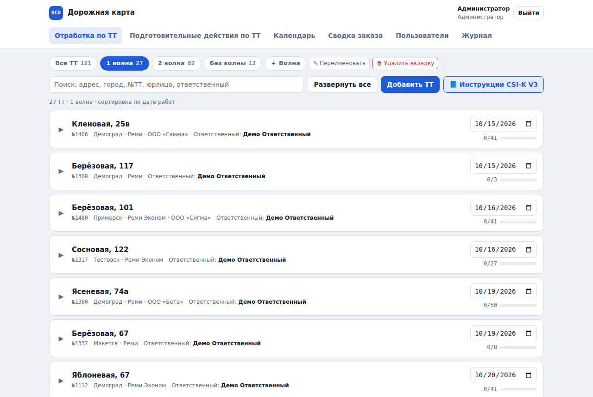
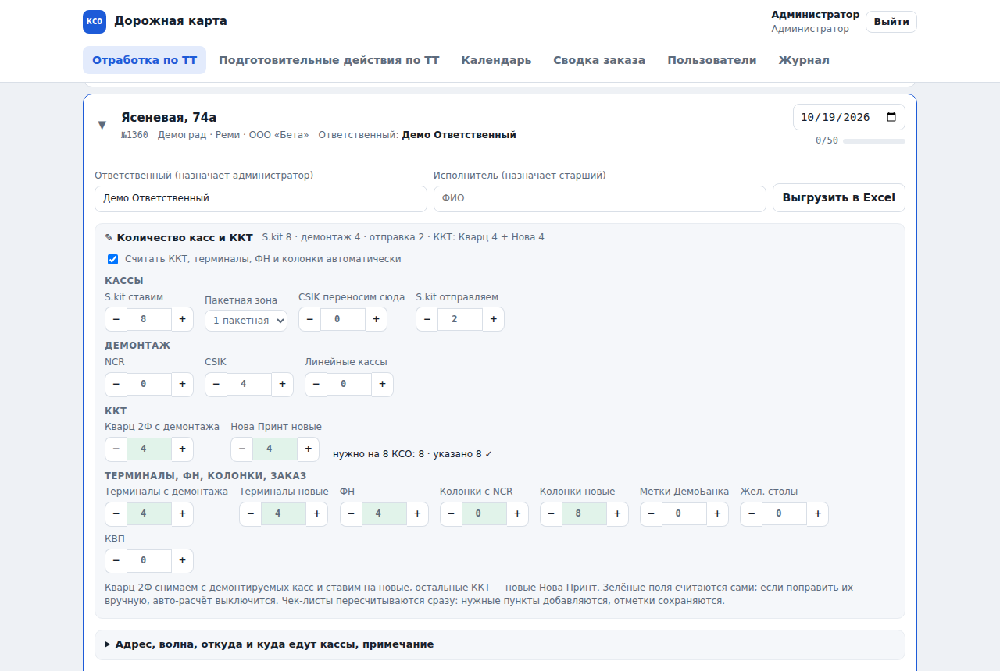
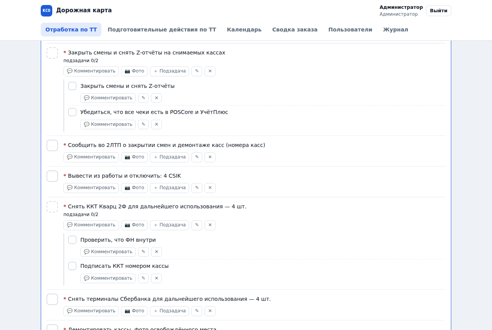
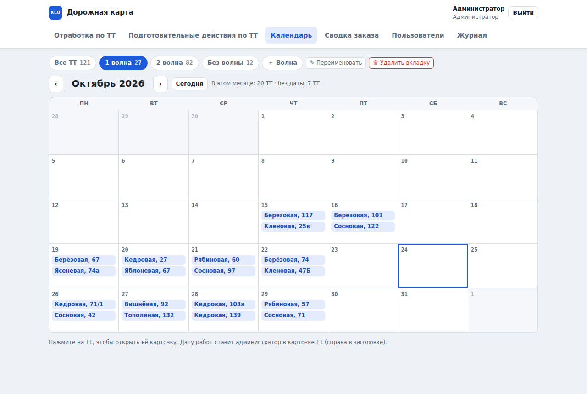
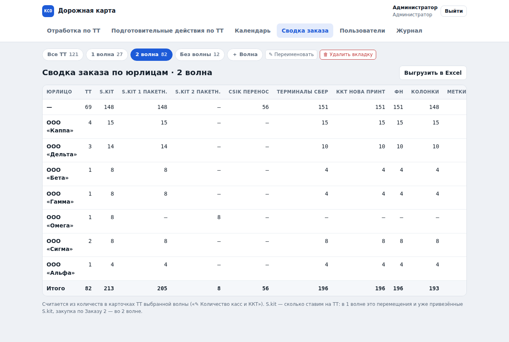
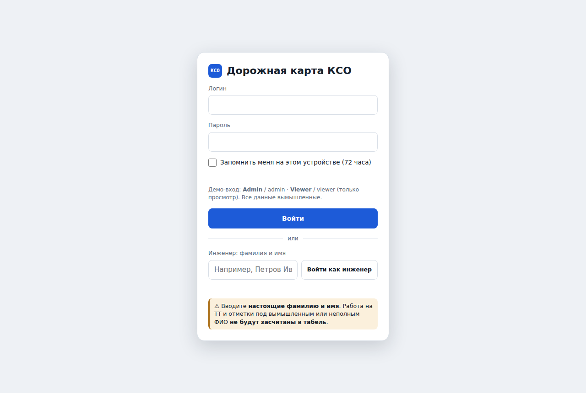
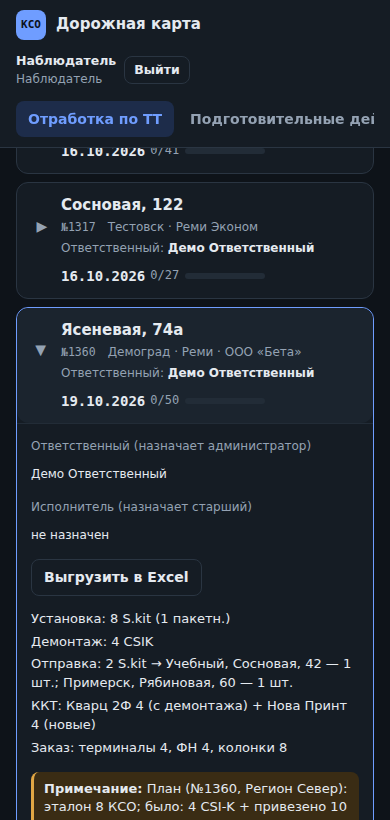

# Дорожная карта КСО

Локальный веб-сайт для планирования и учёта установки касс самообслуживания (КСО) в магазинах сети «Реми»: чек-листы подготовки и работ на ТТ, подтверждение отметок инженеров старшим, волны установки, календарь, сводка заказа и выгрузка в Excel.

> **Демо-версия.** Все ТТ, адреса, юрлица, коды магазинов и план установки — вымышленные.



## Возможности

- **Два раздела**: «Отработка по ТТ» и «Подготовительные действия по ТТ» — ТТ раскрываются, у каждой дата работ, ответственный, исполнитель и чек-лист с подзадачами, комментариями и фото.
- **Роли**: администратор, старший (можно ограничить списком ТТ), инженер (входит по ФИО без пароля, отметки уходят старшему на подтверждение), наблюдатель (только просмотр).
- **Волны**: вкладки «1 волна», «2 волна», «Без волны»; администратор создаёт, переименовывает и удаляет вкладки.
- **Календарь** работ по датам с учётом волны; на телефоне — списком.
- **Количество касс и ККТ**: кнопки −/+, авторасчёт ККТ (Кварц 2Ф — со снимаемых касс, остальные — новые Нова Принт), чек-листы пересчитываются сразу и не теряют отметки.
- **Шаблон чек-листов один** для всех ТТ; правки пунктов (✎, ✕, «＋ пункт») касаются только своей ТТ.
- **Excel**: чек-лист ТТ с квадратиками для галочек и сводка заказа по юрлицам — без внешних библиотек.
- **Работает без интернета** в локальной сети: Node.js без зависимостей, база — один JSON-файл, ежедневные копии и журнал действий.

## Запуск

**Windows:** скачать репозиторий, дважды щёлкнуть `Start.bat`. При первом запуске он скачает переносной Node.js в `site\runtime` (нужен интернет), дальше сайт работает офлайн. В окне будет адрес вида `http://192.168.1.25:8080` для других устройств сети.

**Любая ОС с Node.js 18+:**

```bash
node site/server.js
# http://localhost:8080
```

| Вход | Логин | Пароль |
|---|---|---|
| Администратор | `Admin` | `admin` |
| Наблюдатель (только просмотр) | `Viewer` | `viewer` |
| Инженер | — | фамилия и имя на странице входа |

Старших создаёт администратор в разделе «Пользователи». Подробная инструкция для пользователей — [README.txt](README.txt).

## Скриншоты

| | |
|---|---|
|  |  |
|  |  |
|  |  |

## Устройство

```
Start.bat              запуск на Windows (находит или скачивает Node.js)
site/server.js         HTTP-сервер, API, сессии, живые обновления (SSE), Excel
site/lib/template.js   шаблон чек-листов и пересчёт без потери отметок
site/lib/migrate.js    перенос базы между версиями и разовая загрузка плана
site/lib/common.js     общий код сервера и браузера (ФИО, количества, сводка)
site/lib/xlsx.js       генератор .xlsx
site/public/index.html весь интерфейс (без сборки и фреймворков)
site/seed.json         демо-ТТ для новой базы
site/lib/plan-*.json   демо-план установки по волнам
data/                  база, фото, журнал, копии (создаётся при запуске, в git не попадает)
qa/                    автотесты на Playwright
prototype/             первый кликабельный прототип
docs/history/          история циклов: запрос → что сделано → ревью и QA
```

## Тесты

```bash
npm i -g playwright && npx playwright install chromium
cp -r . /tmp/kso-a && cp -r . /tmp/kso-b          # тесты запускают сервер в чистой копии
NODE_PATH=$(npm root -g) node qa/qa.js  /tmp/kso-a   # 131 проверка
NODE_PATH=$(npm root -g) node qa/qa9.js /tmp/kso-b   # 89 проверок: перенос базы 3.5 → 4, волны, календарь, ККТ, наблюдатель
```

Подробнее — [qa/README.md](qa/README.md).

## История

Проект делался циклами «запрос → реализация → ревью и QA». Каждый цикл — отдельная ветка `cycle/NN-…`, влитая в `main` merge-коммитом с тегом версии. Описание циклов — в [CHANGELOG.md](CHANGELOG.md) и [docs/history](docs/history).
